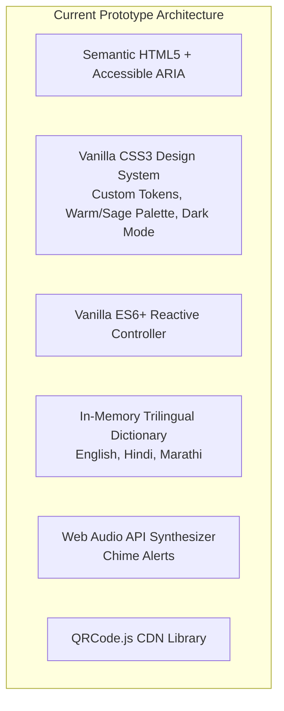
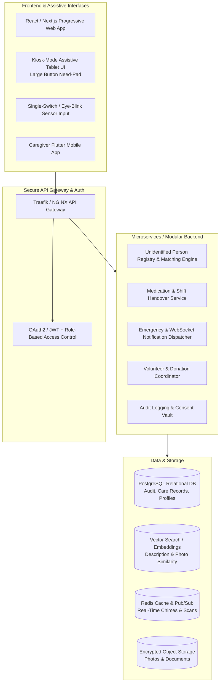
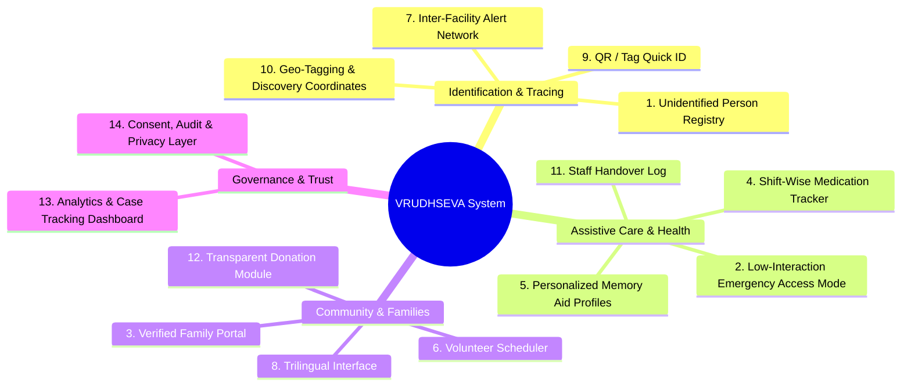
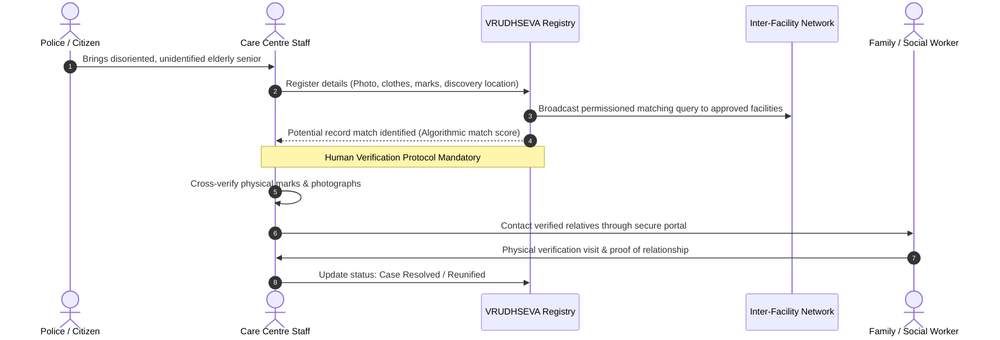
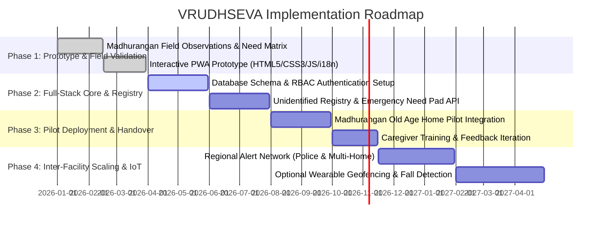

# VRUDHSEVA (वृद्धसेवा) — Project Analysis, Tech Stack & System Architecture Specification

> **Digital Identification, Assistive Care Support, and Family Tracing Platform for Old-Age Homes and Dementia Care Centres**  
> *Academic and Community Initiative inspired by field research at Madhurangan Old Age Home, Shankarpur, Khapri, Nagpur.*

---

## 1. Executive Summary & Project Intentions

### 1.1 Core Mission & Purpose
**VRUDHSEVA** (derived from Sanskrit *Vrudh* = Elderly, *Seva* = Dedicated Service/Care) is an accessible, community-driven digital identification and care-coordination platform engineered specifically for elderly care facilities, old-age homes, and specialized dementia care units. 

The primary intention of VRUDHSEVA is **not** to replace human touch, clinical judgement, or medical practitioners. Instead, it serves as a compassionate technological scaffolding designed to solve critical operational, humanitarian, and accessibility challenges faced by old-age homes:
1. **Unidentified Dementia Wandering & Family Separation**: Bridging the gap when elderly individuals with memory loss (Alzheimer's/dementia) wander away or are brought in by police without identification, contact numbers, or traceable addresses.
2. **Accessible Interaction for Non-Verbal & Motor-Impaired Residents**: Providing assistive, low-interaction emergency communication triggers (large-button visual switchboards, single-switch scanning, blink/tap triggers) so residents who cannot speak or type can express vital needs (pain, water, food, restroom, fear, medical urgency).
3. **Streamlined Daily Care Management**: Eliminating shift-handover information loss regarding medication adherence, dietary intake, mood, behavioural changes, and sleep patterns.
4. **Transparent Community & Family Engagement**: Offering secure communication channels for families, structured scheduling for empathetic volunteers (reading, music, art, walking), and transparent donation management.
5. **Dementia Sensitization & Stigma Reduction**: Dispelling pervasive societal myths surrounding cognitive decline, emphasizing that confused or repetitive behaviour is a medical symptom requiring patience and dignity, not deliberate disobedience.

---

## 2. Field Visit Synthesis: Madhurangan Old Age Home (Nagpur)

### 2.1 Empirical Observations & Ground Realities
The architectural design and feature matrix of VRUDHSEVA originate directly from an academic and community-oriented field visit to **Madhurangan Old Age Home (Shankarpur, Khapri, Nagpur)**:
* **Demographics**: Approximately 20 permanent residents (10 male, 10 female) managed by a dedicated team of ~5 full-time staff members.
* **Collaboration**: Direct dialogues with the branch head, on-duty caregivers, and an accompanying social worker.

### 2.2 Key Operational Pain Points Identified
| Challenge Observed | Real-World Scenario | System Requirement Derived |
| :--- | :--- | :--- |
| **Police Influx of Unidentified Persons** | Local police frequently rescue disoriented seniors wandering city streets. They are admitted with zero identification, memory of relatives, or documentation. | **Centralized Unidentified Registry & Multi-Modal Matching** (photos, physical marks, clothing, discovery location). |
| **Verbal & Physical Disability** | Dementia patients in advanced stages experience aphasia (loss of speech) and fine motor degradation, making standard mobile apps and keyboards unusable. | **Low-Interaction Emergency Access Mode** with oversized high-contrast targets, single-switch scanning, and assistive triggers. |
| **Medication & Routine Inconsistency** | Small homes with rotating shifts rely on manual whiteboards or memory for multi-drug schedules, risking missed doses or double dosage. | **Shift-Wise Medication Tracker** with adherence percentages, delay notes, and handover confirmation. |
| **Isolation & Lack of Cognitive Stimulation** | Residents need regular affection, routine, and memory-stimulating engagement rather than just medical warehousing. | **Personalized Memory Aid Profiles** & interactive engagement tools (matching games, familiar music, routine anchors). |
| **Under-resourced Volunteer Coordination** | Volunteers wish to help (reading stories, chatting, walking), but homes lack scheduling tools to balance visits. | **Volunteer Scheduler & Needs Register** matching volunteer skills with facility calendars. |

---

## 3. Technology Stack Analysis

### 3.1 Current Implementation (Prototype Phase)
The repository currently hosts a client-side progressive web prototype (`index.html`) engineered for zero-dependency portability, high accessibility, and demonstration:

#### Technical Merits of Current Prototype:
* **Zero Overhead**: Single self-contained HTML/CSS/JS file requiring no compilation steps or heavy runtimes.
* **Accessibility First**: WCAG 2.1 AA compliant design with `prefers-reduced-motion` detection, full keyboard navigation, single-switch scanning support, and high-contrast color schemes.
* **Trilingual Native Support**: Dynamic in-place translation between **English, Hindi (हिंदी), and Marathi (मराठी)** catering to regional caregivers and volunteers in Maharashtra.
* **Instant Offline Demonstrations**: Interactive simulations for Emergency Need Pads, Memory Card Games, QR Wristband generation, and Medication Adherence.

---

### 3.2 Target Production Architecture (Full-Stack Scaling)
To deploy VRUDHSEVA across regional old-age homes, police welfare help desks, and social work agencies, the system transitions to a resilient multi-tier architecture:

#### Recommended Production Tech Stack:
* **Frontend Framework**: **Next.js (React)** or **SvelteKit** + **Tailwind CSS** with pre-configured accessible component libraries (Radix UI / Headless UI).
* **Assistive Input Integration**: WebRTC / MediaPipe for experimental camera-based blink detection, alongside WebHID / Web Bluetooth API for physical switch accessibility buttons.
* **Backend Runtime**: **Node.js (TypeScript / Fastify)** or **Python (FastAPI)** for high-throughput event dispatching and image/vector matching algorithms.
* **Database Management System**: 
  * **PostgreSQL**: Primary ACID-compliant relational store for residents, medication schedules, audit logs, and users.
  * **pgvector**: Cosine similarity search on facial feature embeddings and textual descriptor embeddings (clothing, physical marks) for cross-facility matching.
  * **Redis**: Real-time WebSocket pub/sub for instant caregiver alerts and single-switch event synchronization.
* **Object Storage**: S3-compatible encrypted storage (MinIO or AWS S3) with client-side encryption for resident photographs.

---

## 4. Comprehensive 14-Feature Specifications

### 1. Unidentified Person Registry
* **Purpose**: Safe documentation of wandering individuals brought in by police or local citizens.
* **Key Attributes**: Secure photo upload, approximate age bracket, gender, visible physical marks/tattoos, attire description upon discovery, spoken language/dialects, medical observations, and police DD/GD (Daily Diary) entry numbers.
* **Safety Mandate**: No public publishing of vulnerable individuals' photos without judicial/magisterial or authorized nodal agency consent.

### 2. Low-Interaction Emergency Access Mode
* **Purpose**: Assistive lifeline for seniors unable to articulate needs verbally or operate fine-touch interfaces.
* **Key Modalities**:
  * **Six Core Need Buttons**: Oversized, high-contrast, universally colored buttons (*Pain, Water, Food, Restroom, Fear/Anxiety, Medical Urgent*).
  * **Single-Switch Auto-Scanning**: Sequentially cycles through needs at customizable intervals (1.2s - 2.5s); resident triggers selection with a single tap, foot-switch, or head-bump.
  * **Audio Confirmation & Feedback**: Low-frequency soothing tone to confirm receipt without startling the resident.

### 3. Family Communication & Reunification Portal
* **Purpose**: Closed, verified communication bridge between care home authorities and families.
* **Capabilities**: Direct visit slot bookings, health progress digests, milestone sharing, and structured verification workflows for potential reunification claims.

### 4. Medication Tracker
* **Purpose**: Shift-wise adherence verification ensuring zero missed or duplicated dosages.
* **Capabilities**: Drug name, dosage strength, scheduled time window (morning, afternoon, evening, SOS), administration status (*Given, Delayed, Missed*), reason recording for refusals, and live adherence percentage calculation.

### 5. Personalized Memory Aid Profiles
* **Purpose**: Humanizing the resident beyond their medical chart.
* **Capabilities**: Maintains preferred names, hometown memories, favorite regional songs, religious hymns, family photos, calming cues, and known anxiety triggers to guide caregivers and volunteers in empathetic de-escalation.

### 6. Volunteer Scheduler
* **Purpose**: Channeling community goodwill effectively without overwhelming home routines.
* **Capabilities**: Slot-based registration for non-clinical enrichment activities: reading newspapers/books, conversational companionship, music listening, arts & crafts, and assisted garden walking.

### 7. Inter-Facility Alert Network
* **Purpose**: Distributed search network across participating old-age homes, government shelters, and police desks.
* **Capabilities**: Dispatches privacy-preserving broadcast inquiries when an unidentified senior is found, cross-referencing missing person reports across districts.

### 8. Multilingual Support
* **Purpose**: Removing linguistic friction for ground-level caregivers and local families.
* **Current Languages**: Full UI localization in **English, Hindi (हिंदी), and Marathi (मराठी)**, architected with extensible JSON key catalogs to incorporate Gujarati, Kannada, and other regional languages.

### 9. QR / Tag Quick ID Wristbands & Bedside Badges
* **Purpose**: Rapid identification and emergency contact display without compromising sensitive health records.
* **Privacy Guardrail**: QR code payload resolves only to basic facility contact details (*"Madhurangan Old Age Home, Call: +91-XXXXX, Please stay with individual"*). Medical history is **never** embedded in public-facing QR text.

### 10. Geo-Tagging & Discovery Coordinates
* **Purpose**: Spatial tracking of where wandering individuals were originally discovered.
* **Capabilities**: Map coordinate logging linked to municipal police station jurisdictions to assist officers in tracing local neighborhood reports.

### 11. Staff Handover Log
* **Purpose**: Preventing information silos between day and night shifts.
* **Capabilities**: Shift reports tracking sleep patterns, nutritional intake, aggressive/confused episodes, minor injuries, and pending clinical tasks.

### 12. Transparent Donation Module
* **Purpose**: Directing community generosity toward genuine operational deficits.
* **Capabilities**: Live visual indicators of verified material needs (e.g., adult diapers, specific chronic medications, winter bedding, grocery staples) preventing surplus wastage.

### 13. Analytics & Case Progress Dashboard
* **Purpose**: Administrative oversight for home directors, social workers, and trust trustees.
* **Metrics**: Total residents sheltered, pending identification cases, average reunification timeline, monthly medication compliance rates, and volunteer hour aggregates.

### 14. Consent, Audit & Privacy Layer
* **Purpose**: Ethical data governance safeguarding vulnerable elderly individuals.
* **Safeguards**: Role-Based Access Control (RBAC), immutable audit logs of profile views and edits, guardian/nodal consent markers, and mandatory double human verification before confirming identity matches.

---

## 5. End-to-End System Workflow: Identification to Reunification

---

## 6. Assistive Tech Design Principles (Dementia & Motor Limitation)

1. **Large Cognitive Touch Targets**: Minimum interactive dimensions of $64\times 64\text{ px}$ to accommodate kinetic tremors and arthritic conditions.
2. **Predictable Linear Focus**: Single-switch traversal follows top-to-bottom, left-to-right grid paths with high-contrast indicator borders ($4\text{ px}$ solid highlight).
3. **Calm Sensory Feedback**: Warm tones (Teal `#1F6F78`, Sage `#5E7D5C`, Soft Coral `#F4A58A`, Cream `#FFF8F0`) avoiding clinical hospital whites or alarming neon hues that induce dementia agitation.
4. **Zero Penalty Design**: No timed timeouts that erase progress; accidental taps easily dismissed with large, single-touch reassurance prompts.

---

## 7. Phased Implementation Roadmap

---

## 8. Conclusion
**VRUDHSEVA** transforms field-tested social realities into thoughtful software engineering. By centering on dignity, patience, and non-verbal accessibility, the system bridges the gap between vulnerable seniors, frontline caregivers, authorities, and searching families.

*VRUDHSEVA: Because no elderly person should be left unidentified, unheard, or uncared for.*

